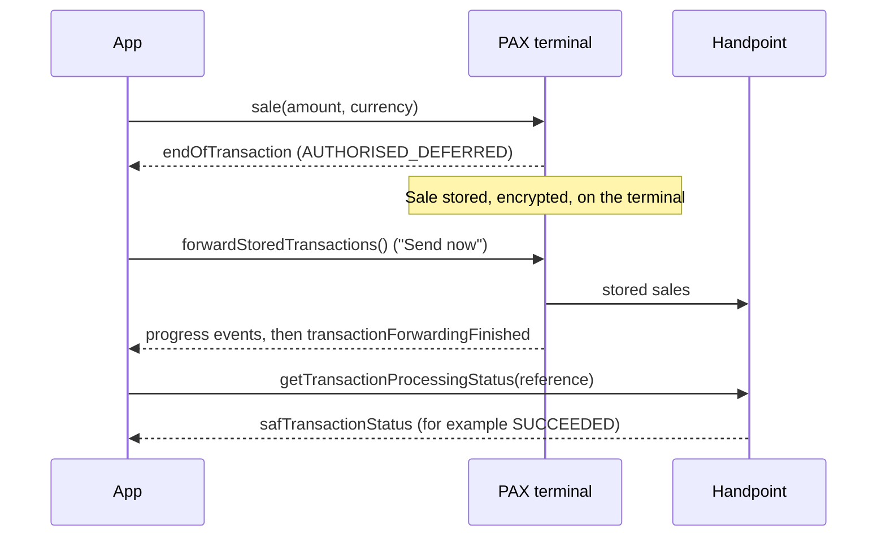

# saf-client

An Android reference app for **Store and Forward (SAF)** with the Handpoint Android SDK 7.1014.1 on PAX terminals. Clone it, run it, and read the code to learn how to add SAF to your own app.

It is a working point-of-sale app, written in Kotlin with Jetpack Compose, Hilt and Room. It takes sales, stores them on the terminal, sends them to Handpoint on request, and shows what happened to each sale.

## Store and Forward in 60 seconds

With SAF, the terminal approves a sale offline and keeps it, encrypted, on the terminal. Your app sends the stored sales to Handpoint later.



Key points:

- Every sale made through the SAF API is stored, even when the terminal has a network.
- The terminal does not send anything by itself. Your app must call `forwardStoredTransactions()`.
- "Forwarded" is not "processed". Ask for the processing status to learn the final result.

## Prerequisites

- A PAX terminal with Store and Forward enabled by Handpoint.
- SAF currency: USD. A terminal handles one currency.
- Your shared secret.
- Access to the Handpoint Maven repository (user and password from Handpoint).
- JDK 17.
- Android SDK 36.

## Setup

1. Add the Maven credentials to `~/.gradle/gradle.properties`. Never put them in the project.

   ```properties
   MAVEN_URL=http://nexus.handpoint.ninja:8081/repository/public/
   MAVEN_USER=provided-by-handpoint
   MAVEN_PASSWORD=provided-by-handpoint
   ```

   The repository uses plain HTTP. `settings.gradle.kts` allows that for this repository only, and asks it only for `com.handpoint` artifacts.

2. Copy `local.properties.example` to `local.properties` (it is gitignored) and fill it in.

   ```properties
   sdk.dir=/path/to/Android/sdk
   handpoint.sharedSecret=replace-me
   # Optional. Default: USD
   #handpoint.safCurrency=USD
   ```

The 7.1014.1 SDK needs the shared secret. In this version the factory that works without credentials is disabled. The secret goes into `BuildConfig.SHARED_SECRET` at build time.

### Protecting the shared secret

This app compiles the shared secret into `BuildConfig`. Anyone who has the APK can read it. That is acceptable for a reference app on a test terminal. For production, do not put the secret in the APK: provision it securely, for example from your backend or through TMS, at run time.

## Build and install

```bash
./gradlew installDebug        # build and install on the connected terminal
./gradlew testDebugUnitTest   # run the unit tests
```

## Where the integration lives

Only the files in `data/handpoint/` and `di/AppModule.kt` import `com.handpoint.api`. The rest of the app uses the domain types. Paths are under `app/src/main/kotlin/com/handpoint/safclient/`.

| File | What it covers |
|------|----------------|
| `data/handpoint/HandpointSafTerminal.kt` | The calls: `start`, `stop`, `sale`, `stopCurrentTransaction`, `forwardStoredTransactions`, `getStoredTransactions`, `getTransactionProcessingStatus`, `deleteStoredTransaction`, `printReceipt`, `registerEventsDelegate`. Also the timeouts and the "outcome unknown" rule. |
| `data/handpoint/SdkEventBridge.kt` | The events: `connectionStatusChanged`, `currentTransactionStatus`, `endOfTransaction`, `transactionResultReady`, `noTransactionsToForward`, `transactionsToForward`, `transactionForwarded`, `transactionForwardingFinished`, `transactionsStoredList`, `storedTransactionDeletedSuccessfully`, `errorDeletingStoredTransaction`, `safTransactionStatus`, `unexpectedSafTrasnsactionStatusError`. |
| `data/handpoint/SdkMappers.kt` | SDK types to domain types: `FinancialStatus`, decline keys, `SafTransactionStatus`, `ForwardingTransactionStatus`, `StatusInfo`, `Currency`, `TransactionReference`. |
| `di/AppModule.kt` | The factory: `HapiFactory.getStoreAndForwardPaymentsApi(delegate, HandpointCredentials(secret), Settings())`. |

## Behaviour your integration must handle

Each item is an SDK fact. The pointer shows where this app handles it.

- [ ] **One forwarding run at a time.** The SDK refuses a second run while one is active. `SendStoredSales` joins the active run, and `isRunning` disables "Send now" (`domain/usecase/SendStoredSales.kt`).
- [ ] **No automatic retries and no ordering.** A sale that is not sent stays stored. Call forward again. Do not expect any order (`SendStoredSales.kt`).
- [ ] **Forwarding starts only when the app asks.** Nothing is sent on a timer. The "Send now" button calls `SendStoredSales` (`ui/sending/SendingViewModel.kt`).
- [ ] **A 60 s inactivity timeout, added by the app.** If no SDK event arrives for 60 s, the run ends as a network stop with the progress so far. Sales not reported as sent stay STORED (`SendStoredSales.INACTIVITY_TIMEOUT`).
- [ ] **Offline decline reasons.** `errorMessage` is translated into the card or device language. Map the untranslated key in `_statusMessage` instead: `PREPAID_CARD`, `EXCEEDED_MAX_AMOUNT_BY_PAN`, `EXCEEDED_MAX_AMOUNT`, `EXPIRED_CARD`, `TEXT_ERROR_CURRENCY`, `TEXT_CARD_NOT_SUPPORTED` (`SdkMappers.kt`, `toDeclineReason`).
- [ ] **SDK-check rejections have no reference.** When the SDK refuses a sale (for example, wrong currency), `sale` returns `operationStarted = false` and the result arrives in an `endOfTransaction` with a blank reference. The app waits 2 s for it (`HandpointSafTerminal.REJECTION_TIMEOUT`).
- [ ] **Sale timeout or cancel: outcome unknown.** The app calls `stopCurrentTransaction` and returns `Failed(OUTCOME_UNKNOWN)`. Stopping works only before the card is read, so the terminal may still have stored the sale. Reconcile with `getStoredTransactions`. **Never retry blindly: you can charge the customer twice** (`HandpointSafTerminal.awaitSaleEnd`, `ReconcileStoredSales`). An unexpected `FinancialStatus` is also an unknown outcome (`SdkMappers.kt`).
- [ ] **The terminal is the authority for what is stored.** A sale can be stored on the terminal without its result reaching the app. The SDK gives only its reference, so the app cannot add it to its list. Home counts the terminal's last answer to `getStoredTransactions`, says how many stored sales are not in the app's list, and keeps "Send now" enabled so they are forwarded (`ReconcileStoredSales.lastSummary`, `ui/home/HomeViewModel.kt`).
- [ ] **Delete only what is still on the terminal.** `deleteStoredTransaction` can answer that the sale is not on the terminal. Then it was most likely forwarded and charged: do not remove it from your records. The app marks it as sent and tells the merchant it cannot be deleted (`DeleteStoredSale.kt`).
- [ ] **SDK spelling.** The error event is `unexpectedSafTrasnsactionStatusError` ("Trasnsaction"). Keep the typo when you override it (`SdkEventBridge.kt`).
- [ ] **Forwarded is not processed, and there is no batch status.** Handpoint processes forwarded sales asynchronously, so ask for their result later. `getTransactionProcessingStatus` takes one sale; there is no batch query. Ask with a light touch: only sales without a final status, sent in the last 24 h, one at a time, at most 20 per pass, and stop at the first sale with no answer. After a run this app asks about the sales just sent at 10 s, 30 s and 2 min; Home asks again at most every 5 min (`domain/usecase/RefreshOpenStatuses.kt`). While a sale is still queued, Handpoint answers `IN_PROGRESS` without asking the gateway.
- [ ] **Status values and the no-regress rule.** Values: `STORED`, `IN_PROGRESS`, `SUCCEEDED`, `FAILED`, `CAPTURED`, `REFUNDED`, `CANCELLED`, `NOT_FOUND`. A final status never changes. A status answer never moves a sale into `STORED`, and moves a `STORED` sale only to a final status, because answers can be stale. Only the terminal's list of stored sales moves a sale into or out of `STORED` (`domain/model/ProcessingStatus.kt`, `domain/usecase/RefreshSaleStatus.kt`, `ReconcileStoredSales`).
- [ ] **No card brand offline.** The SDK does not return the card brand for offline sales (it is `OTHER`). The app shows the masked number and the entry mode only (`SdkMappers.kt`).
- [ ] **The terminal is ready only when it is connected.** `start()` returns before the SDK has loaded its configuration. Until `connectionStatusChanged(Connected)`, `getStoredTransactions` reports the SDK's default currency (GBP), not the terminal's. This app reconciles only when the terminal is connected (`ReconcileStoredSales`).
- [ ] **`transactionsStoredList` amounts.** `totalAmount` is the batch limit (`maxAmountPerBatch`). The amount of the stored sales is `amountProcessed` (`SdkEventBridge.kt`).
- [ ] **Store and Forward limits are in minor units.** In TMS, `maxAmountPerTransaction = 100` means 1.00, not 100.00. A sale over the limit is declined with `TEXT_ERROR_AMOUNT` before the card is read.
- [ ] **SAF limits are not exposed.** The SDK does not tell you the terminal limits. Handle declines such as `EXCEEDED_MAX_AMOUNT` when they happen.
- [ ] **One currency per terminal.** The app reads the currency from the stored total and saves it as a setting (`ReconcileStoredSales`, `data/settings/AppSettings.kt`, `handpoint.safCurrency`).

## Architecture

The code is in three layers. Dependencies point inwards: `ui` and `data` depend on `domain`. `domain` depends on neither.

| Layer | Package | Content |
|-------|---------|---------|
| Domain | `domain/` | Models (`Sale`, `Money`, `ProcessingStatus`, ...), ports, use cases. Plain Kotlin. |
| Data | `data/` | Adapters: the Handpoint terminal (`data/handpoint`), the Room journal (`data/journal`), settings (`data/settings`), logging (`data/logging`). |
| UI | `ui/` | Compose screens and view models: home, sale, sending, detail, settings. |

**Ports** (interfaces in `domain/`):

- `StoreAndForwardTerminal`: everything the app asks of the SDK.
- `SalesJournal`: the local list of sales.
- `AppPreferences`, `ErrorReporter`.

**Use cases** (`domain/usecase/`):

| Use case | Job |
|----------|-----|
| `TakeSale` | Take a sale and save it in the journal when it is approved offline. |
| `SendStoredSales` | Run forwarding, mark each sale as sent, reconcile at the end. |
| `RefreshSaleStatus` | Ask for the processing status and save it. |
| `ReconcileStoredSales` | Make the journal agree with the terminal, and keep the terminal's last answer. |
| `DeleteStoredSale` | Delete a stored sale from the terminal. A sale already gone from the terminal is kept and marked sent. |

**The local journal.** The SDK has no history of sales. It lists only what is still stored on the terminal, and a status needs a call per sale. The app keeps its own journal in Room (`data/journal/`) so it can show every sale and its status. The terminal stays the source of truth for what is stored: the journal never decides on its own that a sale left the terminal, or that a sale is not on it. `ReconcileStoredSales` fixes the journal when they differ. A STORED sale the terminal no longer lists becomes IN_PROGRESS; a sale the terminal still lists goes back to STORED. Sales that change while the terminal answers are left as they are.

## Tests

```bash
./gradlew testDebugUnitTest
```

No terminal and no network are needed. The tests use a fake SDK (`app/src/test/kotlin/com/handpoint/safclient/testutil/FakeSafApi.kt`) and fake ports. They cover:

- the SDK adapter: lazy creation, events, sale outcomes, timeouts, cancel, forwarding, status and delete (`data/handpoint/`);
- the mappers: decline keys, statuses, forwarding results (`SdkMappersTest`);
- the use cases: one run at a time, inactivity timeout, reconcile, no-regress (`domain/usecase/`);
- the Room journal and the settings;
- the view models and the Compose screens (Robolectric).

## Known pitfalls

- **Native libraries must be extracted.** The PAX SDK loads its `.so` files from the app's extracted `lib/` directory. With `minSdk` 24 or higher, AGP does not extract them by default, and the app crashes at start with `UnsatisfiedLinkError` (`libDeviceConfig.so`). Set `packaging.jniLibs.useLegacyPackaging = true` and keep `ndk.abiFilters` to `armeabi-v7a` and `armeabi`: the SDK ships a complete set of native libraries for 32-bit ARM only (`app/build.gradle.kts`).

## Known limitations

- Sale only. There is no refund or void.
- No simulated mode yet. You need a real terminal to run the app.
- If the app is killed in the middle of a sale after the card was read, that sale may not appear in the journal. It may still be stored on the terminal. Home counts it after the next reconcile and "Send now" forwards it, but the app cannot show its details.
- Robolectric runs on Android SDK 35 (`robolectric.properties`) because it does not support SDK 36 on JDK 17.
- The guide link in Settings points to a claude.ai artifact (`SAF_GUIDE_URL` in `ui/settings/SettingsScreen.kt`).
