<div align="center">

# Store and Forward · Android reference app

**Keep selling when the network goes down.**
A complete PAX app built to production standards. It shows how to take card payments offline with the Handpoint Android SDK, send them later, and know what happened to each one.


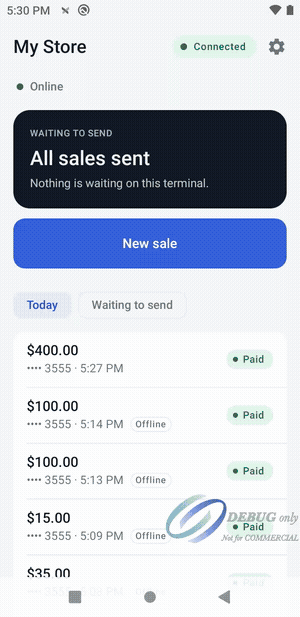

[▶ Watch the full demo (1:45)](docs/media/demo.mp4)

</div>

---

## Why Store and Forward

A shop does not stop selling because the Wi-Fi dropped. With Store and Forward, the terminal approves the sale offline and keeps it **encrypted on the device**. Your app sends it to Handpoint when the network is back, and Handpoint processes each sale **once and only once**.

| | |
|---|---|
| 🛡️ **No lost sales** | The sale is stored on the terminal the moment it is approved, even if the app closes right after. |
| 🔁 **No double charges** | Every step, from the device to the processor, ignores repeats of the same sale. |
| 🔐 **No card data at risk** | The reader encrypts the request with DUKPT. The PAN is never stored in the clear. |
| 🎛️ **Your app is in control** | Nothing is sent in the background. Your app decides when to send and asks for each result. |

This app also **switches between online and offline sales by itself.** With a network, sales are approved online at once. Without one, they are stored and sent later.

## See it in action

<table>
  <tr>
    <td align="center" width="25%">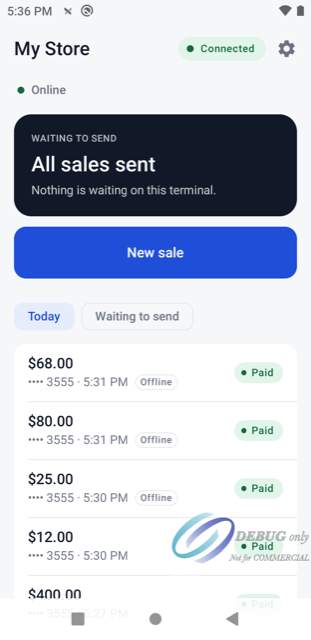<br/><b>Online</b><br/><sub>Sales are approved at once</sub></td>
    <td align="center" width="25%">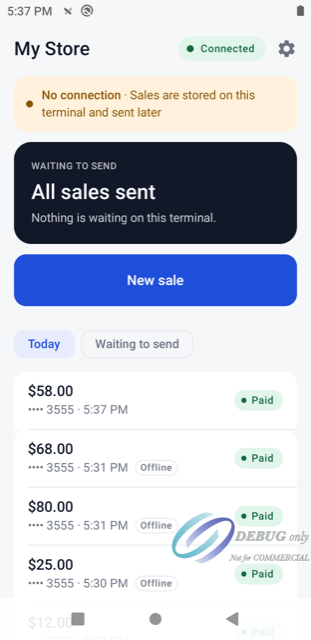<br/><b>No connection</b><br/><sub>A clear banner, and selling continues</sub></td>
    <td align="center" width="25%">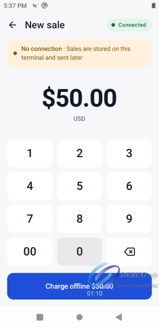<br/><b>Charge offline</b><br/><sub>The merchant always knows the mode</sub></td>
    <td align="center" width="25%">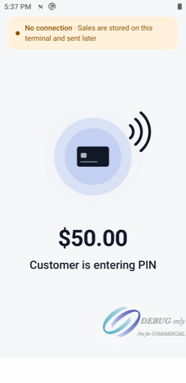<br/><b>Tap, insert or swipe</b><br/><sub>Live card steps from the SDK</sub></td>
  </tr>
  <tr>
    <td align="center">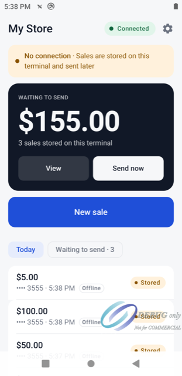<br/><b>Waiting to send</b><br/><sub>Counted from the terminal itself</sub></td>
    <td align="center">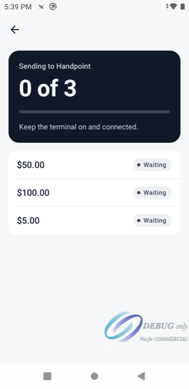<br/><b>Send now</b><br/><sub>Live progress, one run at a time</sub></td>
    <td align="center">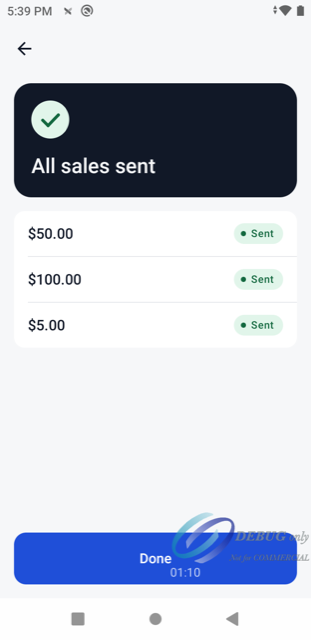<br/><b>All sales sent</b><br/><sub>Then the app asks for each result</sub></td>
    <td align="center">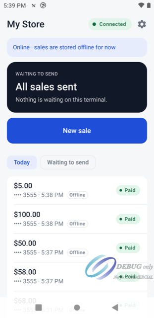<br/><b>Paid</b><br/><sub>Status updates by itself</sub></td>
  </tr>
  <tr>
    <td align="center">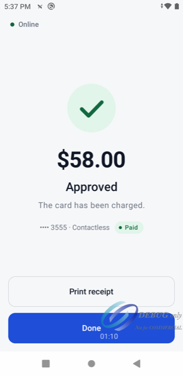<br/><b>Approved online</b><br/><sub>Immediate result with a network</sub></td>
    <td align="center">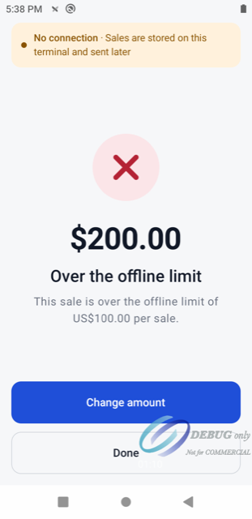<br/><b>Clear declines</b><br/><sub>The SDK's own message, with the limit</sub></td>
    <td colspan="2" valign="middle">
      <b>Built like a real POS app</b><br/><br/>
      ✔ Light and dark themes, AA contrast<br/>
      ✔ Large touch targets for a terminal screen<br/>
      ✔ Respects reduced motion<br/>
      ✔ Every state designed: empty, offline, sending, errors<br/>
      ✔ Never offers "Try again" when a sale may already be charged
    </td>
  </tr>
</table>

<sub>Screenshots taken on a PAX A920MAX in the Handpoint staging environment. The "DEBUG only" mark is the terminal's own debug watermark.</sub>

## How it works

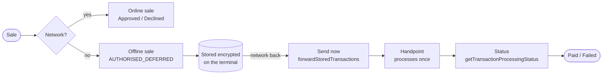

The SDK has two payment APIs, and only one can run at a time. This app picks the right one by itself:

| Network | Sales waiting to send | API in use | What the merchant sees |
|---------|-----------------------|------------|------------------------|
| No | any | Store and Forward | 🟠 "No connection · Sales are stored on this terminal and sent later" |
| Yes | some | Store and Forward | 🔵 "Back online · 3 sales waiting to send" + **Send now** |
| Yes | none | Online | 🟢 "Online" |

Only the Store and Forward API can send stored sales and ask for their status. So when the network comes back with sales still on the terminal, the app stays offline until they are sent. Then it switches to online by itself.

## Quick start

**You need:** a PAX terminal with Store and Forward enabled by Handpoint, its shared secret, access to the Handpoint Maven repository, JDK 17 and Android SDK 36.

**1. Maven credentials** go in `~/.gradle/gradle.properties`, never in the project:

```properties
MAVEN_URL=http://nexus.handpoint.ninja:8081/repository/public/
MAVEN_USER=provided-by-handpoint
MAVEN_PASSWORD=provided-by-handpoint
```

**2. Your terminal** goes in `local.properties`. Copy `local.properties.example`; the file is gitignored.

```properties
sdk.dir=/path/to/Android/sdk
handpoint.sharedSecret=replace-me
# Optional. Default: USD
#handpoint.safCurrency=USD
```

**3. Build and install** on the terminal, connected by USB:

```bash
./gradlew installDebug        # build and install
./gradlew testDebugUnitTest   # run the 335 unit tests; no terminal needed
```

> [!IMPORTANT]
> **Use SDK 7.1014.2 or later for currencies other than GBP.** In 7.1014.1 and earlier, every offline sale that is not in GBP is declined (SDKS-437). The SDK version is `handpointSdk` in `gradle/libs.versions.toml`.

> [!TIP]
> In TMS, Store and Forward **limits are in minor units**: `maxAmountPerTransaction = 100` means **1.00**, not 100.00. The currency and the limits come from the merchant's Store and Forward settings (or the acquirer's), not from the terminal.

## Where the integration lives

Everything that talks to the SDK is in **five files**. The rest of the app sees only plain domain types, so you can read the whole integration in one sitting. Paths are under `app/src/main/kotlin/com/handpoint/safclient/`.

| File | What you will find |
|------|--------------------|
| [`data/handpoint/HandpointSafTerminal.kt`](app/src/main/kotlin/com/handpoint/safclient/data/handpoint/HandpointSafTerminal.kt) | The Store and Forward calls: `start`, `sale`, `forwardStoredTransactions`, `getStoredTransactions`, `getTransactionProcessingStatus`, `deleteStoredTransaction`, `stopCurrentTransaction`, `printReceipt`. It also handles timeouts, declines before the card is read, and the "outcome unknown" rule. |
| [`data/handpoint/HandpointOnlineTerminal.kt`](app/src/main/kotlin/com/handpoint/safclient/data/handpoint/HandpointOnlineTerminal.kt) | The online calls and outcomes: `AUTHORISED`, `DECLINED`, `CANCELLED` and unknown. |
| [`data/handpoint/SdkEventBridge.kt`](app/src/main/kotlin/com/handpoint/safclient/data/handpoint/SdkEventBridge.kt) · [`SdkMappers.kt`](app/src/main/kotlin/com/handpoint/safclient/data/handpoint/SdkMappers.kt) | Each SDK event as a Kotlin `Flow`, and the mapping from SDK types to domain types: decline codes, statuses and forwarding results. |
| [`di/AppModule.kt`](app/src/main/kotlin/com/handpoint/safclient/di/AppModule.kt) | The two factories: `HapiFactory.getStoreAndForwardPaymentsApi(…)` and `HapiFactory.getAsyncInterface(…)`. |
| [`domain/PaymentModeCoordinator.kt`](app/src/main/kotlin/com/handpoint/safclient/domain/PaymentModeCoordinator.kt) | The mode rule and the switch between the two APIs. |

## What your integration must handle

These are SDK facts we confirmed on a real terminal. Each item points to the code in this app that handles it.

<details open>
<summary><b>Connecting and configuration</b></summary>

- [ ] **The terminal is ready only at `Connected`.** `start()` returns before the SDK has loaded the terminal's configuration. Until `connectionStatusChanged(Connected)`, `getStoredTransactions` reports the SDK's default currency, GBP. Reconcile only when connected (`ReconcileStoredSales`).
- [ ] **Only one payment API runs at a time.** Creating one API clears the other's event listeners. To switch, stop the active one, create the other, register the delegate again, connect, and wait for `Connected`. Never switch during a sale, a forwarding run or a status check (`PaymentModeCoordinator`).
- [ ] **Only Store and Forward sends stored sales.** The online API has no `forwardStoredTransactions`. Stay on Store and Forward while sales wait to be sent (`PaymentModeCoordinator`).
- [ ] **Each terminal takes one currency.** The app takes the currency from the terminal once it is connected (`ReconcileStoredSales`, `handpoint.safCurrency`).

</details>

<details open>
<summary><b>Taking a sale</b></summary>

- [ ] **Each decline has a code and a message.** Map the untranslated code, and show the SDK's `errorMessage`. From SDK 7.1014.2 the message states the limit as money: "This sale is over the offline limit of $1.00 per sale." The codes are `SAF_TRANSACTION_LIMIT_EXCEEDED`, `SAF_CARD_LIMIT_EXCEEDED`, `SAF_BATCH_LIMIT_EXCEEDED`, `SAF_CURRENCY_NOT_ACCEPTED`, `TEXT_ERROR_AMOUNT`, `EXPIRED_CARD`, `PREPAID_CARD` and `TRANSACTION_DECLINED` (`SdkMappers.kt`, `ui/sale/SaleCopy.kt`).
- [ ] **Some declines happen before the card is read.** `sale` returns `operationStarted = false`, and the code arrives in an `endOfTransaction`. From 7.1014.2 that event carries the sale's reference and `errorMessage` is filled in. The app waits 2 s for it (`HandpointSafTerminal.rejectionOutcome`).
- [ ] **A declined amount offers "Change amount", not "Try again"** (`SaleCopy.kt`).
- [ ] **A timeout or cancel means the outcome is unknown.** Call `stopCurrentTransaction`, which works only before the card is read. Then reconcile with `getStoredTransactions`. **Never retry blindly: you can charge the customer twice** (`HandpointSafTerminal.awaitSaleEnd`, `ReconcileStoredSales`).
- [ ] **Offline sales have no card brand.** The SDK returns `OTHER`, so show the masked number and the entry mode instead (`SdkMappers.kt`).

</details>

<details open>
<summary><b>Sending and status</b></summary>

- [ ] **Sending starts only when your app asks.** There is no timer. "Send now" calls `SendStoredSales` (`ui/sending/SendingViewModel.kt`).
- [ ] **One run at a time, no automatic retries, no guaranteed order.** A second call while a run is active is refused. Unsent sales stay stored. Add your own inactivity timeout; this app uses 60 s between events (`SendStoredSales`).
- [ ] **Sent is not processed, and there is no batch status.** Ask for each sale's result later, and keep the load low:
  - only open sales from the last 24 h;
  - one at a time, at most 20 per pass;
  - after a run, ask at 10 s, 30 s and 2 min;
  - from Home, ask at most every 5 min.

  This is `RefreshOpenStatuses`. While a sale is still queued, Handpoint answers `IN_PROGRESS` without reaching the gateway.
- [ ] **A status never goes backwards.** A final status stays final. Only the terminal's list moves a sale into or out of `STORED` (`RefreshSaleStatus`, `ReconcileStoredSales`).
- [ ] **The terminal decides what is stored.** A sale can be stored without its result reaching the app. Home counts what the terminal reports and keeps "Send now" enabled (`HomeViewModel`).
- [ ] **"Not on the terminal" usually means "already sent".** If a delete answers `NO_EXISTING_TRANSACTION`, mark the sale as sent. Do not tell the merchant it was deleted (`DeleteStoredSale.kt`).
- [ ] **`transactionsStoredList` amounts.** `totalAmount` is the batch limit; the stored total is `amountProcessed` (`SdkEventBridge.kt`).
- [ ] **The SDK spells one event with a typo.** The error event is `unexpectedSafTrasnsactionStatusError`; keep that spelling when you override it.

</details>

## Architecture

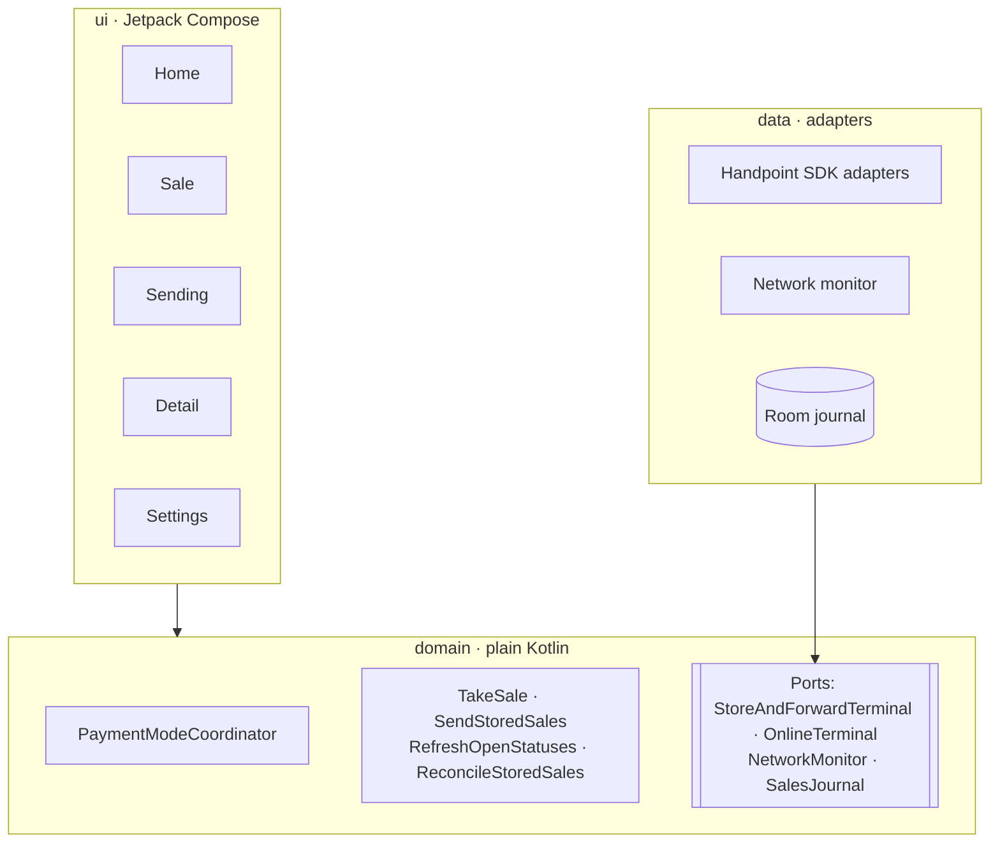

- **`domain/`** holds the models, the ports and the use cases. It depends on no other layer.
- **`data/`** implements the ports: the two Handpoint adapters, the network monitor, the Room journal and the settings.
- **`ui/`** holds the Compose screens and their view models.

**Why a local journal?** The SDK keeps no sales history. It lists only the sales still stored, and getting a status takes one call per sale. So the app keeps every sale in Room, with its channel (online or offline) and its status. The terminal is still the source of truth for what is stored, and `ReconcileStoredSales` corrects the journal when the two differ.

## Tests

```bash
./gradlew testDebugUnitTest
```

There are 335 unit tests. They need no terminal and no network: they use hand-written fakes of both SDK APIs (`testutil/FakeSafApi.kt`, `testutil/FakeHapi.kt`). They cover:

- the SDK adapters: events, sale outcomes, declines, timeouts, cancel, forwarding, status and delete;
- the mode rule: no network, sales waiting, never switching during a sale, the 30 s timeout, retry backoff and the 60 s rule after a network drop;
- the network debounce, the journal migration, the mappers and the use cases;
- the view models and the Compose screens (with Robolectric).

## Good to know

- **Sales only.** The app has no refund or void.
- **An online sale with an unknown outcome** is kept as "Check with Handpoint" and is never retried.
- **Online and offline sales use the same currency** (`handpoint.safCurrency`).
- **While online, the app does not check offline sales sent earlier.** It checks them the next time it uses Store and Forward.
- **If the app is killed mid-sale** after the card was read, the sale may be missing from the journal. It is still on the terminal, so Home counts it and "Send now" sends it.
- **The shared secret is compiled into `BuildConfig`.** That is fine on a test terminal. In production, provide it at run time instead, for example from your backend or through TMS.
- **On PAX, native libraries must be extracted.** Set `packaging.jniLibs.useLegacyPackaging = true` and limit `abiFilters` to `armeabi-v7a` and `armeabi`. Otherwise the app crashes at start with `UnsatisfiedLinkError` (`app/build.gradle.kts`).
- **Robolectric runs on Android SDK 35**, because it does not support SDK 36 on JDK 17.

---

<div align="center">
<sub>Built by Handpoint, part of EPI. For questions, contact your Handpoint integration contact.</sub>
</div>
